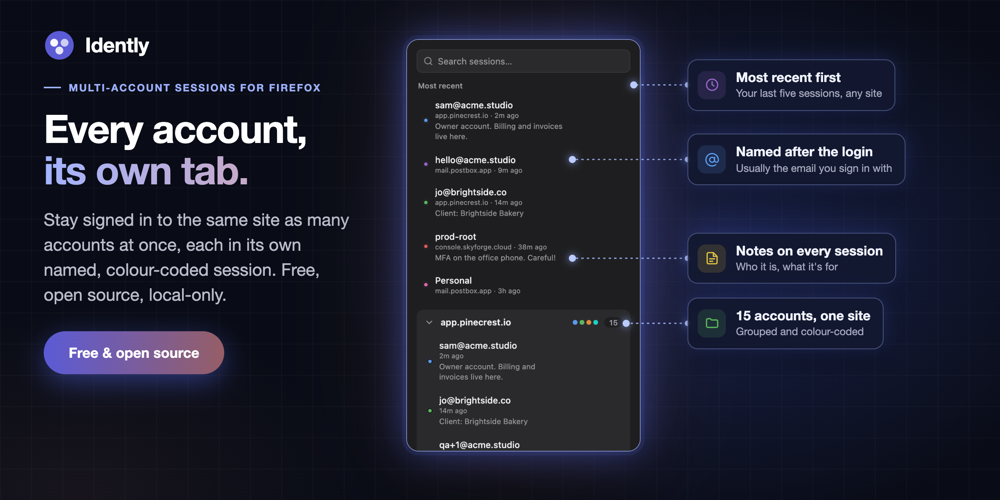
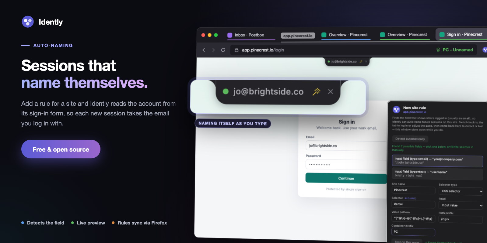

<a href="https://addons.mozilla.org/firefox/addon/idently/"></a>

A free, open source Firefox extension for people who sign in to the same site
as several different accounts: clients, test users, admin and personal. Each
login gets its own named, colour-coded session in its own tab, and a small
notch on the page always tells you which one you're in.

Click **New session tab** on any site and Idently opens it in a fresh Firefox
container, a separate cookie jar, so you can sign in as someone else without
signing out of anything. Name it, give it a colour and a note, and it's one
click away from then on.

> **No account, no server, no tracking. Idently makes no network requests at all.**

It's built for lots of logins. Say you look after fifteen clients, each with
its own account on the same dashboard: that's fifteen sessions on one site, each
named after the email it signs in with (`jo@brightside.co`,
`accounts@mossandco.com`, `admin@harbourdental.nz`...). Sign in once and the
session names itself. Next week, type `harbour` into the popup and press Enter
to be back in that client's account.

## Features

- **Every account, its own tab.** Each session is a Firefox container with its
  own cookies and storage. Sessions are grouped by site in the popup, with the
  most recent first, and their tabs are filed into a tab group named after the
  site.
- **The session notch.** A notch hangs from the top of every page that belongs
  to a session, showing its name and colour. Click to copy the name,
  Option-drag to move it along the top edge, × to hide it until the page
  reloads. It can be turned off in Settings.
- **Auto-naming.** A site rule points at the field that holds the account,
  usually the email box on the sign-in form, and the new session takes its name
  from it. The notch previews the name as you type. **Create rule for this site**
  in the popup's menu detects likely fields and tests them on the page.
- **Search.** The popup opens with search focused. Names, sites and notes are
  searched together, every word has to match, and Enter opens the selected
  session.
- **Logged-out flag.** Sessions whose container has no cookies left for their
  site are marked *logged out*.
- **Edit anything.** Name, notes, colour and domain. Changing the domain merges
  duplicate groups such as `account.example.com` into `example.com`.
- **Backup.** Export sessions to JSON, with or without their cookies, and import
  them into another profile or computer.
- **Recovery.** Firefox keeps containers when an extension is removed. After a
  reinstall, Settings → Recover containers adopts them back, logins intact.



## Idently and Multi-Account Containers

Idently doesn't replace Mozilla's Multi-Account Containers. Think of it as a
more in-depth take on the same idea, for when you have a lot of logins.
Multi-Account Containers suits a few long-lived containers like Work and
Personal. But it doesn't name containers for you, and one flat list gets hard to
manage past a handful. Idently names sessions from the login email, groups them
by site, makes them searchable, and labels each page with the session it's in.

You can run both at once. They share Firefox's containers, so Idently's sessions
appear in Multi-Account Containers as containers named `site - name` (or
`prefix - name` when a site rule sets a short prefix). Multi-Account Containers
isn't required, though: Idently uses Firefox's built-in containers directly
through the `contextualIdentities` API, and installing it switches them on if
they're off.

Firefox doesn't offer containers in private windows, so sessions open in
normal windows only.

## Install

From [Firefox Add-ons](https://addons.mozilla.org/firefox/addon/idently/), or
from source:

1. Clone this repo.
2. Open `about:debugging#/runtime/this-firefox` and click **Load Temporary
   Add-on…**.
3. Pick `manifest.json` from the repo root.

A temporary add-on lasts until Firefox restarts. Requires Firefox 139 or later.

## Privacy

Idently makes no network requests. Sessions (name, notes, colour, site and
container ID) are stored in Firefox's local extension storage. Site rules and
the notch setting are in Firefox's sync storage, which only leaves this
computer if you use Firefox Sync. The full policy, including what each
permission is for, is at
[dazecoop.github.io/idently/privacy.html](https://dazecoop.github.io/idently/privacy.html).

## Development

There's no build step: the repo root is the extension. `test-site/server.js`
is a tiny login site on `localhost:5050` for checking container isolation:

```
node test-site/server.js
```

### Packaging

```
npm run build      # -> dist/idently-firefox-v<version>.zip, for addons.mozilla.org
```

The zip holds only the extension's own files, not `docs/`, `scripts/` or
`store-assets/`.

### Docs site

`docs/` is the GitHub Pages site (Settings → Pages → deploy from the `main`
branch, `/docs` folder), served at
[dazecoop.github.io/idently](https://dazecoop.github.io/idently/). AMO's
homepage, support and privacy policy fields point there.

## Support

If my projects have been useful to you and you'd like to support the work, you can buy me a coffee. Completely optional, but always appreciated!

<a href="https://www.buymeacoffee.com/dazecoop" target="_blank"></a>

## Licence

[MIT](LICENSE)
